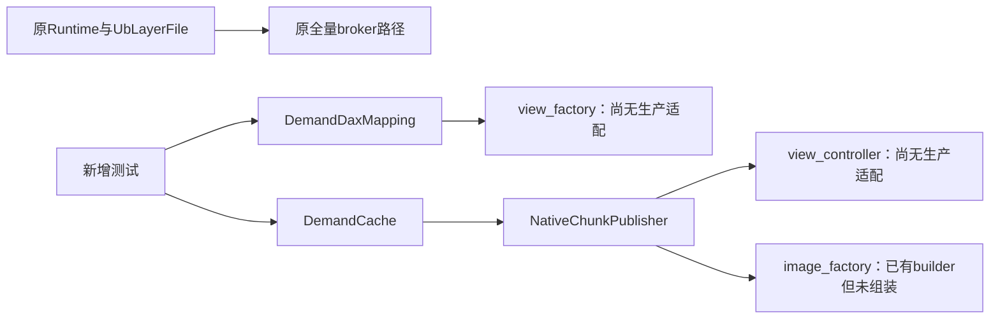
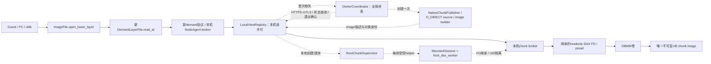
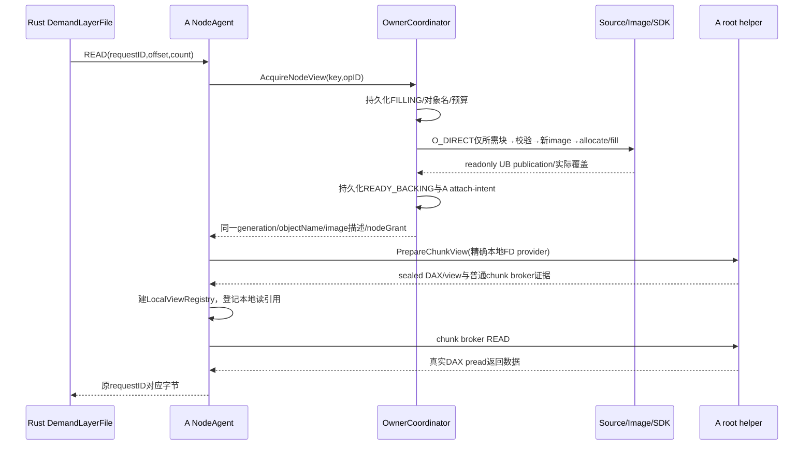

# aenv Host DAX 按需加载：核心设计与验收合同

版本：2026-10-28 / 设计修订2。主设计文档，替代此前仅覆盖组件的初版说明。
阶段：现状核对与设计；本修订完成并呈现前，不新增功能代码。本文中的“计划”不代表实现或实机通过。

## 1. 固定现状、范围与证据

| 对象 | 固定版本/证据 | 可以成立的结论 | 尚不成立的结论 |
|---|---|---|---|
| 已实测全量Host路径 | 核心782577411ff20522d33c22dffb533e9678334fed（local09c0e602）；候选OBMM SHA59767d198966db908e662cfbe0f144b93d8fd20f01a39c917977aa9e8efd8a6a；已有续做/日志修复入口 | A/B读取同一导出区域的8MiB数据，经实际S_DAX/read_iter，各避免8MiB文件数据cache；B已退役 | 不是已完成真实aenv Guest按需；A后续复读/最终恢复因用户保留要求延期；整体净收益NA |
| 全量真实rootfs接合代码 | full branch local8dfa182，公开4185da5e2037f3032ee9ef6bab06f7085403c64b | 已提交root挂载→继承只读DAX FD→普通UID broker的代码和本地测试，值得复用 | 本任务没有新的两节点Guest验收回执，不把该提交称为实机已通过 |
| 按需组件初版 | feat/host-pmem-demand，公开88e86f676471df2a7b5f9b4a5e496fbb3a363b4f / local91e4f01；基于09c0e602 | 可信块manifest、同块miss合并、预算/读票、DAX FD读取适配、直接源读取、chunk镜像和SDK调用代码 | 新类当前只由测试调用；没有实际broker服务入口、两节点控制传输、root视图适配或Rust运行绑定 |

不修改main或全量工作树/服务。按需在独立worktree和分支完成，默认保持旧行为，显式启用。当前A保留的全量小对象/视图及两节点模块不在本设计中自动停止。另一个feat/ub-rootfs-demand-v1属于其他方案，不修改。

范围：不可变rootfs lower的Host后备读取。Guest保持普通块设备；memory lower、Guest RAM CoW和rootfs私有upper保持旧语义。不是Guest virtio-pmem、KVM UB RAM或memfile跨节点私有CoW。

## 2. 三张实际/目标路径图

### 2.1 当前全量路径（组件实现与Host实测分开）

源码锚点：src/snapshot/runtime_support.rs::resolve_ub_runtime_config；storage/overlaybd/src/config.rs::bind_ub_layer_replicas/ub_runtime_config_view；storage/overlaybd/src/image/image_file.rs::open_lower_layer；storage/overlaybd/src/backend/ub.rs::UbLayerFile::open/read_range；storage/overlaybd/src/backend/ub_protocol.rs::Session::open/read_at；components/ub-memory-provider/aenv_ub_provider/{stored.py::Broker,host_dax.py::StoredDaxMapping,host_pmem_session.py::MountedSession,host_pmem_rootfs.py::serve,host_dax_worker.py::Worker.start/child}。后两个模块在full@4185da5，按需分支尚未继承。

### 2.2 当前按需分支实际情况

这张图中的断点是真实未实现项。源码中没有从现有aenv服务到新DemandCache的实际启动/调用，不能用单元测试结果替代运行接合。

### 2.3 首版完整按需路径（实线数据、虚线控制）

直接FD读取适配可以保留，但首版生产路径优先复用full@4185da5已经完成的“root挂载+普通chunk broker”。外层NodeAgent通过同机只读chunk broker读取，增加一次socket/复制，必须计费和测时，不宣称零拷贝。已有view_factory将由ConcreteChunkViewFactory返回有根据信任的ChunkBrokerView；不会用普通文件伪装fd。

## 3. 核心源码改动表

下列模块均在按需分支修改/新增。既有Python组件保持其适合的职责；Rust实际接合是本版本的必要交付。

| 模块/源码 | 当前行为 | 计划改动和功能 | 上下游接口 | 验证方法 |
|---|---|---|---|---|
| src/cfg.rs::SnapshotConfig | 没有按需rootfs模式 | 增加RootfsBackingMode及demand index选项；legacy默认维持旧env语义，显式local/ub_full/ub_demand互斥 | 配置→Runtime resolver | 旧配置序列化/默认兼容、冲突/缺索引失败 |
| src/snapshot/runtime_support.rs | rootfs/memory都用AENV_UB_*_REPLICAS绑定全量索引 | rootfs按模式分派；新增demand配置解析/派生视图，memory路径不改 | SnapshotConfig→image config | full和memory旧路径字节/行为回归；demand不打开源文件 |
| src/snapshot/repository/backends/posixfs/runtime.rs::resolve/resolve_local_managed_layer | 现有UB hint优先 | demand严格绑定到digest+fileBytes+manifest；允许只靠受信索引读取，禁普通源/下载后备 | durable snapshot→runtime config | 丢源文件仍走demand；错digest/size拒绝 |
| storage/overlaybd/src/config.rs::LayerConfig/validate_image_config | Option<UbLayerRef> | 新Option<DemandLayerRef>及version2 metadata-ready demand index；ub与demand不能同设；mapping/wire长度不当UB容量 | resolver→ImageFile | 模式、长度、manifest、fallback禁用校验 |
| storage/overlaybd/src/image/image_file.rs::open_lower_layer | ub或local/remote分支；之后可能prefetch | demand分支最先选择；不调用open_localfile_path/remote/cache下载，不包全量prefetch | LayerConfig→VirtualFile | 真正选择DemandLayerFile；触碰local打开计数必须0 |
| storage/overlaybd/src/backend/demand.rs（新） | 无 | DemandLayerFile实现VirtualFile各read入口，传offset/count/request ID；跨1MiB wire分片、错误向上传播，写入拒绝 | ublk→node demand broker | 实际Rust read_at→真实socket服务集成；失败/短读不回退 |
| storage/overlaybd/src/backend/demand_protocol.rs（新） | 全量只有AENVUB1握手 | 独立AENVDM1协议绑定manifest、层身份、代次；open仅metadata-ready，不分配；请求带ID/状态 | Rust↔NodeAgent | std协议测试、错模式/magic/manifest拒绝、0请求0fill |
| storage/overlaybd/src/rootfs_access_trace.rs | 成功读范围及start/end | 保留旧事件；增加按需request ID、miss/hit/阶段、错误/timeout事件；不能重复计算字节 | 核心read→采集 | 成功/失败计数一致、drop检测、逐sandbox关联 |
| src/sandbox/ublk/device.rs与daemon释放路径 | 释放Guest设备，pool可留placeholder | 验证按需run下最后consumer退出后关闭其业务layer/session；必要时增加按run的drain确认，绝不停无关daemon | Guest退出→node broker lease | Guest退出、pool不保留业务读许可、其他run不变 |
| demand_service.py（新） | 无生产服务入口 | NodeAgent真实实例化按需mapping，发布metadata-ready索引和broker；控制SDK importer、本地view注册、读许可和drain | Rust↔coordinator/root supervisor | 实际请求触发miss；未访问块无发布 |
| demand_control.py（新） | 无跨节点实现 | OwnerCoordinator HTTP/JSON+mTLS，单owner、同块合并、opID幂等查询、预算/状态持久化 | A/B NodeAgent↔owner | 并发X/Y复用、丢响应不再allocate、认证失败无动作 |
| demand_views.py（新） | view_factory/view_controller抽象 | RootChunkSupervisor client + ConcreteChunkViewFactory/ChunkBrokerView；root ready证据与本地wire身份核验 | NodeAgent↔root helper/chunk broker | 实际S_DAX/设备/FD/对象绑定，wrong/full/ordinary后端拒绝 |
| host_pmem_rootfs.py/host_dax_worker.py等full有效提交 | 挂载已有镜像并继承FD | 复用到分支；每chunk一受控helper，payload.bin一文件；保持root私有namespace和普通broker UID | SDK只读FD→DAX chunk broker | 继承FD、降权、忙退休拒绝；Linux实际挂载 |
| demand_source/image/native.py | 有真实调用代码但未组装 | 组装trusted manifest→只读source→chunk image→SDK发布；补importer及每块source身份/状态 | coordinator→UB、B importer→root | O_DIRECT原生、单对象生命周期、budget/覆盖异常 |
| demand_importer.py（新） | 无B生产importer | 每节点一SDK session；B按已有objectName只map不allocate；A本地复用owner只读锚 | 全局描述→本节点RawProvider | B allocateCalls=0，map/unmap/generation记录 |

若src/sandbox/firecracker/instance.rs或FC无需修改：该方案仍给FC普通rootfs块设备，现有VirtualFile读链足够承载，不增加Guest pmem设备。只有现有实测不兼容的调用/参数需具体修正，不能为形式修改FC。

## 4. 配置与协议（明确失败，不隐式选模式）

配置新增snapshot.rootfs_backing_mode：legacy / local / ub_full / ub_demand。legacy只保留旧AENV_UB_ROOTFS_REPLICAS自动full行为；显式demand要求独立demand index。full和demand index冲突、demand模式配普通full索引、缺manifest或缺本机服务均拒绝启动。memory仍只读原AENV_UB_MEMORY_REPLICAS，不复用rootfs demand选项。

DemandLayerRef绑定：brokerSocket、stableLayerObject、runGeneration、layerDigest、fileBytes、logicalWireBytes、manifestSha256、protocolVersion。logicalWireBytes只是完整文件虚拟范围，不是SDK申请或UB映射。任何repositoryFallback字段在demand schema中非法。

Demand index version2/state=metadata_ready/mode=host-dax-demand包含所有lower的上述元数据。它的ready不表示数据驻留；open握手必须核新magic和manifest后返回metadata-ready，allocationCalls和filledChunks仍0。

本机wire采用独立8字节magic AENVDM1\0；握手传层身份/代次/digest/length/manifest SHA。读取传requestID、offset、count（每片<=1MiB）；返回同requestID、状态、actualBytes和payload。容量不足、deadline、uncertain、身份失败、短读等均为明确非零状态。任一失败使Rust session不再健康，不自动重连换后备。错误传播到Guest/CLI，原300/330秒任务语义保持。

## 5. 全局owner、节点agent与root helper的具体接口

### 5.1 OwnerCoordinator（普通UID，单SDK session）

A为协调者是一种角色选择，不代表物理内存在A。owner registry key=(catalogSHA,layerDigest,chunkIndex)，意图先写generation/objectName，再调用SDK。chunk source路径只能来自启动时固定的catalog，RPC不能传任意本地文件路径。静态catalog含完整文件/块摘要和范围，不持有payload。

生产控制使用JSON over HTTPS+mTLS。证书fingerprint在run配置中绑定node ID；不接受客户端自报node ID覆盖证书身份。限制消息长度、方法、catalog、run epoch、chunk index与budget。Rust不接触跨节点控制和凭据，只连接本机broker。

接口：AcquireNodeView(run,catalog,chunk,operationID)、QueryOperation(operationID)、QueryChunk(key)、CloseAdmission(run)、ConfirmNodeReleased(key,generation,rootReceipt)、ShutdownRun。首次AcquireNodeView为节点持久化attach-intent，再返回同一publication及nodeGrant。重发同operationID只查已存结果；UNKNOWN不调用allocate。网络超时可查询相同opID，但不能换名字重试创建。

### 5.2 NodeAgent（普通UID；本地broker和SDK importer）

同机NodeAgent维护LocalViewRegistry。首次命中尚无本地view的块，向owner取nodeGrant，A复用owner本地只读锚、B只map已有对象。SDK同机共存能力需先核源码/原生：若未证实与保留全量SDK进程可共存，部署前保持关闭，不擅停全量服务。不得用随意忽略SDK全局锁的方式上线。

NodeAgent生成本节点RawProvider只读FD socket，再调用本机RootChunkSupervisor.Prepare。节点open-view请求也有稳定operationID，意图先落盘；SDK map结果未知时不再次map。

LocalViewRegistry缓存的是小量描述/连接/已验证读许可，不缓存payload。稳定命中只增加本机引用并调用chunk broker读，不逐请求做远端RPC或全journal fsync。全局nodeGrant在view存在期间保持pin；root supervisor只有关闭所有本机读入口并确认reader归零后才允许退休。全局owner超时不能撤销此pin。

### 5.3 RootChunkSupervisor（root，只监听本机Unix socket）

Unix目录root所有，指定组可遍历，socket0660；SO_PEERCRED绑定批准的NodeAgent UID/PID/startTicks和run。root配置固定允许的catalog、公钥/owner身份、kernel/candidate、每镜像大小、最大view数和根目录。原始SDK仅在普通进程加载。

接口PrepareChunkView(key,generation,publication,localProviderIdentity)、ViewStatus(operationID)、RetireChunkView(key,generation)、ReconcileRetirement(operationID)。没有任意命令或任意mount路径接口。

Supervisor从本地已确认SDK socket取得真正readonly O_SYNC OBMM FD；核fd来源/大小、image SHA及source manifest。以新私有目录启动同版本host_pmem_rootfs helper：MountedSession创建本地卷/namespace/ro,noload,dax=always,nodev,nosuid,noexec挂载。files只含payload.bin，其stored replica用chunk digest/长度。复用host_dax_worker.Worker传递readonly文件FD至普通UID子进程；不chmod root私有挂载目录给所有人，也不将SDK加载进root。

Prepare回执含operationID、chunk key/generation、root helper PID/start/boot、volume UUID/device、文件inode/长度/S_DAX/readonly、broker PID/start和runtimeIndex SHA。NodeAgent与RootSupervisor socket验证root peer，核回执与请求；ChunkBrokerView再次按chunk replica打开本机broker，拒绝错误generation/size/digest。

该RootSupervisor是view_controller的生产实现；ConcreteChunkViewFactory/ChunkBrokerView是view_factory的生产实现。它们的代码必须存在并由NodeAgent启动调用，不能留为用户自行注入回调。SDK image factory同样固定组装demand_image.build_chunk_image。

## 6. 逐场景时序

### 6.1 创建模板、打开lower但没有content read

准备manifest可O_DIRECT扫描原文件并保存hash，不分配UB；不是Guest访问。NodeAgent启动读取catalog、生成metadata-ready index；Rust创建DemandLayerFile和本机连接，只握手验证身份，不调用AcquireNodeView。若aenv格式解析随后确实读取LSMT/tar/index元数据，这是实际lower read，可以触发对应块，单列bootstrap集合S0；不能为校验整层SHA或预取扫描全文件。删除DemandDaxMapping.open中的全层verify仍保留。

### 6.2 A首次读取未加载块

复制点：source O_DIRECT对齐缓冲<=约1MiB；producer临时payload/image文件；SDK写入UB；SDK/节点首挂验证读取；DAX pread到chunk broker缓冲→同机socket→NodeAgent→同机socket→Rust/FC。每一步成本单列，没有“零复制”承诺。临时镜像普通缓存要实测、建议回收，不隐去。

### 6.3 A重复访问

Rust相同调用→NodeAgent命中LocalViewRegistry→本地读引用++→现有chunk broker pread→返回→引用--。不重新分配/填充/全块hash；NodeGrant仍持久pin。若命中Guest缓存而根本没有lower请求，只记Guest观测，不造UB hit事件。

### 6.4 B访问已加载块

B NodeAgent无本地view→AcquireNodeView同key→owner返回A已创建同publication，allocateCalls不增加→B importer readonly map已有对象（allocateCalls=0）→B root helper本地seal/mount/DAX校验→读。跨节点数据访问是否发生由实际export/import区间判断，不以A发布者角色推断。

### 6.5 A/B同时首次访问

Owner按key状态锁合并为一个FILLING；各请求opID不同但等待同一generation。只有一个SDK allocate。发布后分别登记A/B attach-intent。等待超时不取消正在执行的创建、不创建替代对象。owner失联，节点保留已有grant/FD；没有grant的新请求报错。

### 6.6 跨块读取

Rust先按wire上限分片；NodeAgent再按manifest块边界拆分。每片取得对应view许可，按原offset顺序拼接，返回actualBytes必须等于请求。任一片失败，不返回未初始化或混代次数据，不落回普通文件；已创建块保留记录。不同chunk generation不同，但各自hash必须对应同一不可变layer manifest。

### 6.7 中途失败/丢响应

| 失败位置 | 行为 | 可继续条件 |
|---|---|---|
| trusted manifest/源chunk hash不符 | 不发布给读者，保存错误 | 修正源/manifest后新run，不能忽略hash |
| allocate/map调用结果未知 | key进入UNCERTAIN，保留预算与对象名 | 显式SDK/节点核对，不自动再allocate |
| readonly backing已确认，root Prepare回执丢失 | node attach-intent保留 | QueryOperation/同opID root status；不能重复mount |
| helper启动前可证实失败 | 记录PRE_EXEC_FAILED | 仅在精确无事务/无SDK/无helper证明下显式续做 |
| root helper/FD/broker结果未知或死掉 | nodeGrant和UB保持 | root卷与FD状态显式核对；死亡不是退役证明 |
| 容量不足 | 明确CapacityExceeded/EIO，未分配新对象 | 新批准预算/新run；无在线自动淘汰 |
| read错误/短读/deadline | Rust错误传播，session不再自动重连 | 任务失败保留，不忽略超时凑完成 |
| deallocate回执丢失 | RELEASE_UNCERTAIN，仍收费 | 查询确切对象/日志确认，不能先减账 |

### 6.8 退出与最终释放

1. CloseAdmission停止本run新请求，不停全量模式或别的run。
2. 用户要求停止本runGuest；Runtime/daemon确认设备业务映像/session不再持有，不能仅GET库存空。
3. 各NodeAgent冻结LocalViewRegistry新读，等待实际本机读引用0，关闭chunk broker连接。
4. RootSupervisor正常retire worker（拒绝活跃lease），确认子进程成功退出、关闭继承FD，再正常卸载/销毁卷并查询不存在。
5. B importer关闭raw FD和SDK map，生成同key/generation的明确释放回执；A本地view同样确认。任何未知节点不视为已退出。
6. Owner验证每个attach-intent/nodeGrant都已完成对应root/SDK释放，关闭owner RawProvider/FD/readonly map，deallocate该chunk；逐对象ACK后减账。所有对象退出后才finalize该run SDK session。
7. 保留journal/失败回执/静态产物。首版没有跨重启自动恢复；发现旧事务先进入RECOVERY_REQUIRED，不能重置缓存表开启新run。

## 7. 粒度、空间和首版上限

证据：匹配UBSE源码ubse_mem_constants.h的ALIGN_SIZE、MIN_IMPORT_MEM_SIZE_PER_SOCKET、OBMM_MEMORY_BLOCK_SIZE_CONFIG均有128MiB配置/边界；ubse_mem_scheduler_request.cpp::AlignRequestSize按节点GetBlockSize取整。原实机64MiB逻辑镜像映射覆盖128MiB。不能由此证明所有硬件配置都只有128MiB，但当前不能承诺8MiB物理按需。

首版采用120MiB payload上限/128MiB逻辑ext4 image，metadata余量8MiB；最后一个不足120MiB的块也按该单位构建。实际formatter不足/SDK覆盖超出预留就失败，不静默换成更大对象。只读封存整个region、不可就地复写，故每块是独立不可变发布。

初始软件预算建议2GiB、最多16个128MiB发布，作为待现场清单审查的候选值，不是已经授权的目标分配。每次预留128MiB后才SDK create；map后实际覆盖若超128MiB保留真实收费并停止发布。该检查不能阻止平台内部池分配超出软件预留，不能叫物理硬配额。

v1不做在线淘汰，retire_idle在生产服务中不对外开放，仅完整drain后的退出用；达到预算明确失败。这样先消除两端在读情况下的LRU再装载协议复杂度。后续在线淘汰另设计，不能直接启用初版组件中的模型API。

空间/读取放大要实测：4KiB首次请求可能触发最多120MiB payload读取+128MiB image填充，另有首挂/内容校验读取；128MiB SDK对象可能对应不同实际区域覆盖。64MiB小例子可能仍占128MiB，不宣称改善。GiB镜像只有少数块被触及时才可能减少活跃容量；随机触及全部、metadata遍布或过小chunk会接近/超过全量成本。

## 8. 状态机、持久化和代次

全局块：UNLOADED→ALLOCATE_INTENT/FILLING→READY_BACKING→RELEASING→RELEASED。创建/填充/删除未知→UNCERTAIN；禁止自动离开UNCERTAIN。已有文件/静态manifest不等于数据已加载。

节点视图：NONE→ATTACH_INTENT→SDK_MAPPED→ROOT_PREPARING→VIEW_READY→DRAINING→LOCAL_RELEASED；任意未知→VIEW_UNCERTAIN。global key包含catalog/layer/chunk，数据对象generation每次新的发布唯一。nodeGrant还绑定node ID、boot/run epoch、root视图ID、SDK对象代次，旧回执不能释放新对象。

锁与日志：同key Condition合并fill；SDK初始化和所有权修改在每节点session锁内；不同READY块热读不取全局SDK锁。副作用前fsync意图，确认后fsync结果；禁止每个热读对远端RPC或全journal fsync。本机读引用由LocalViewRegistry线程锁管理，全局持久node pin由root视图实际退出证据释放。进程崩溃时宁可保留pin，不能假定内存计数消失即可回收。

操作结果查询只返回同opID结果。完整状态记录包括实际SDK覆盖、root卷/设备、kernel/模块/配置SHA、PID/start/boot、metadata/content验证和每个node ACK。日志写失败后停止新副作用，拒绝恢复预算。SDK adapter同机多进程共存和现有全量session兼容性仍需源码/原生证据；若不满足，不擅停保留服务，也不默认绕过全局锁。

## 9. 启动不全量加载的可观测判据

- metadata index与wire握手：SDK data allocateCalls=0/filledChunks=0。
- aenv格式open确实发出的metadata reads：记录bootstrap S0及字节，允许按块装载，但不全层hash/预取。不能将S0排除UB成本。
- 访问集合X、Y之后：READY集合必须恰好由S0和对应真实后端read所触及块组成；未触及块仍UNLOADED，没有按整镜像预留地址空间对应的全量UB allocation。
- 分别显示有效请求字节、加载payload、image逻辑申请、实际map覆盖及唯一导出区域。不能把少复制字节冒充物理节省。

## 10. 验证顺序和准入

### 本地等级

L1 单元/模型：配置、manifest、并发合并、预算、代次、错回执、失败保留。只证明逻辑。

L2 实际核心调用链：编译修改后的Rust核心，真实DemandLayerFile.read_at→真实本机wire服务→真实NodeAgent状态机。DAX/SDK边界若模拟，报告明确模拟；重点证明不是测试直接调用DemandCache。错路径必须使LocalFile/download打开计数0。

L3 Linux原生：隔离构建（不部署服务）、O_DIRECT尾读、chunk镜像mke2fs、真实SDK/OBMM/S_DAX/readonly/FD传递/退出。现有FC、内核、OBMM候选、adapter未变就复用，原生构建结果记录实际摘要。Windows无法跑的项目不能记pass。

### 两节点最小aenv/Guest验收

每节点先一个Guest，使用同一模板。不是四模板或性能规模测试。记录aenv open实际bootstrap集合S0，之后A触发实际rootfs读集合X，B触发与X部分重叠集合Y，再重复读取；预先安排至少一个保留未访问块Z。

Guest读取文件和存储lower偏移并非一一对应（LSMT索引、压缩、预读会转换）；以实际rootfs read trace派生X/Y/Z块集，不能把Guest文件offset直接充当stored lower offset。使用已固定模板文件/最小Guest读取器；若快照Guest缓存吞掉请求，必须证明实际lower请求出现，不清全机缓存、不用Host独立读替代。不能保证X/Y满足重叠/未访问就判测试输入不合格，重新设计输入而不是伪造集合。

通过标准：握手不分配；实际aenv read引发首次publish；X∩Y共同key只一次allocate；重复读取无新fill；Z未分配；S_DAX/readonly/驱动DAX计数与真实对象区间配对；无普通文件/长期本地payload后备；partial failure状态明确；正常退出各node视图/SDK/global对象退役链全部确认。

完整验收前不扩展到四模板。Host自测只作L3前置，不能代表aenv/Guest通过。

## 11. 收益与性能账

沿用原四沙箱设计的指标层次：Host/FC RSS/PSS1s，文件lower/memory lower/upper、设备缓存、VMA、服务进程15s，请求级时延与1s有效吞吐；核心最小验收先限制数据量，之后再做同负载三版本对照。

单列：Host文件数据PageCache；UB填充payload；逻辑image/对齐；唯一活跃对象覆盖；池预留/可可靠观测的新增物理量；源文件/临时image残余缓存；普通broker与SDK/root helper、缓冲、metadata/kernel成本。DAX文件mincore不当PageCache，PSS不当UB物理量，Host Cached差值不单独归因。

首miss与本机命中、已发布但首次跨节点attach分别统计，分段记source/image/SDK/root-view/等待/真实DAX pread；存在重叠不相加。实际本地/远端来源按export/import区间判定，发布者不一定内存所在地。物理增量无法测时净收益NA，不能把cache避免量当净收益。

## 12. 实施顺序、验收条件与尚未解决项

| 步骤 | 交付 | 进入下一步的证据 |
|---|---|---|
| D0 本设计呈现 | 实际路径、具体模块、协议、粒度/退出/测量 | 用户可审阅；关键接口有明确上下游，无未解释factory |
| I1 继承full已提交有效FD/生命周期组件 | 在独立branch有选择复用8dfa182对应代码 | 原full ref/worktree未改；本分支旧full测试继续过 |
| I2 Rust显式模式和DemandLayerFile | 配置/派生config/打开/实际read/error/trace接通 | Rust构建、full兼容、open不分配、read wire真实集成 |
| I3 Coordinator和NodeAgent | 真实服务实例化、mTLS、同key状态/opID、LocalViewRegistry | 并发/丢响应不重复、hot读无远端RPC、budget错误实际传播 |
| I4 RootChunkSupervisor和importer | 每块SDK/RawFD/rootview/继承FD broker及retire具体实现 | Linux原生FD/设备/metadata/退出测试，mock只作L1 |
| I5 匹配版本交付 | 固定源码、包/二进制摘要、显式启用配置、最少中转入口 | build/deploy/recovery可审查，运行前具体资源授权 |
| V 最小两节点Guest | S0/X/Y/Z、同对象复用、未加载、正常/失败释放 | 实际Guest/rootfs trace+SDK/DAX证据完整；数据完整落盘后可引用 |

问题分类：

- 可复用：普通块设备Guest、UbLayerRef全量链、SDK adapter、现有OBMM ABI、MountedSession、full已提交FD worker/退休合同。
- 代码尚未实现：本表所有新增生产路径，尤其typed demand config/backend/protocol、服务组装、root supervisor和跨节点传输；已有7个新增组件不能替代它们。
- 接口能力需核：当前SDK同机session共存、既有统计是否提供真实池物理增量、已有FC/模板构建兼容性；没有证据时不能设为true。
- 已有证据约束：当前已验证region整段readonly seal禁止原地refill；当前UBSE默认/配置路径128MiB对齐，与实测一致。这不等于硬件所有配置都不支持更细粒度。
- 实机待验：chunk image实际覆盖、root helper子进程/FD实际行为、miss耗时、真实X/Y/Z、两端失败释放、容量收益。

设计没有要求更换内核/改OBMM。若实现发现必须改变现有模块或影响保留服务，先说明具体差异与恢复，再请求该额外操作授权；不能悄悄扩大。新GiB级预算不是旧64MiB授权的自动延伸。全过程由用户中转，助手不直连A/B，也不向其他会话发消息。
