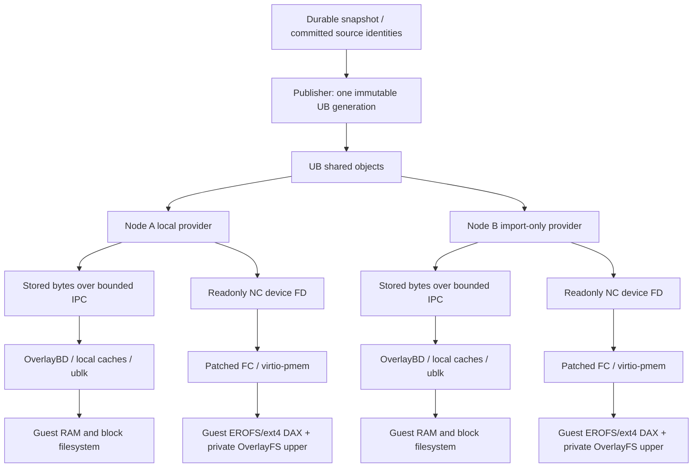

# Cross-node CoW: implementation and acceptance boundary

This branch is an opt-in implementation candidate. It is not an end-to-end
validated implementation of globally shared Guest RAM and rootfs. Existing
sandbox behavior is retained when the new environment variables are absent.

The separate [lazy rootfs cache](lazy-rootfs-cache.md) adds demand filling and
bounded, pinned eviction to the stored-layer path. It does not add a missing-page
handler to native pmem/DAX, and its preallocated cache capacity must be counted
as a cost rather than equated with the bytes filled by the workload.

## Two different sharing paths



The stored-layer path shares **stored immutable bytes** for both memory and
rootfs. It does not eliminate IPC copies, each node's decoded memory device,
Guest RAM, or Guest filesystem cache. It must not be reported as direct sharing
of all Guest base physical pages.

The native rootfs path exposes compact, uncompressed filesystem images directly
as readonly pmem. The Guest mounts EROFS or explicitly selected ext4 with DAX and overlays a private writable
ext4 directory. DAX is checked on every nonempty regular file in each lower and
the initial visible root. The final probe is checked again after envd readiness.
A failed DAX check is a failed launch, not permission to use an ordinary cache
path. Application buffers, parsed data, private writes, page tables and pmem page
metadata still consume memory.

## Components

* AgentENV validates immutable identities, acquires same-UID provider leases and
  passes both data and lease FDs into isolated children. The NC verifier has zero
  capabilities and verifies the full device range without mapping it in the
  Runtime. Device faults fail that child. Cancellation retains ownership until
  reaping; inherited lease sockets also pin stalled children.
* `components/ub-memory-provider` uses public UB shmem APIs compiled against the
  installed SDK headers. Publish and import roles are separate. Import never
  allocates or deletes publisher objects. All parameters are explicit; there are
  no hostnames, fixed UIDs, deployment paths, service operations or SDK installers.
* `components/firecracker-native-pmem` supplies an explicitly versioned NC device
  FD backend. It duplicates all inherited segments, preserving `O_SYNC`, and maps
  them into one owned aligned range. It does not seek, pread, reopen `/proc/self/fd`, or manufacture
  a local copy. The patch applies only to the source hashes in `baseline.json`.
* `components/native-fd-verifier` is the isolated executable used above.
* `tools-image` supplies Guest pmem/EROFS/ext4/OverlayFS startup and the DAX checker.
* `aenv-export-memory` exports a full linear immutable RAM view with sparse zero
  ranges in its **local output file**. This does not make a UB allocation sparse.

## Opt-in configuration

Stored-layer runtime hints use `AENV_UB_MEMORY_REPLICAS` and
`AENV_UB_ROOTFS_REPLICAS`, pointing to node-local `runtime-index.json` files.
The durable repository remains authoritative. Bindings require matching digest
and length, and fallback defaults to false. A native rootfs binding cannot be
combined with the rootfs stored-layer hint for the same launch.

`AENV_DIRECT_ROOTFS_BINDING` selects the version-2 cold-boot pmem binding made by
the provider's `bind-rootfs` command. It pins verifier and FC binary SHA256s,
source identities, per-layer image hashes and lengths, and an explicit exposed
address-range limit. The provider socket and binaries must be configured for
each node. Source identities and content hashes are portable; FD numbers and
socket paths are not.

The optional `lowerFilesystem` field is a strict `erofs`/`ext4` choice and
defaults to EROFS for existing bindings. All lowers in one binding use that
type. Ext4 lowers are immutable 4KiB-block images without inline data or a
journal requiring replay; mount options are `ro,noload,dax=always`. The upper
remains a separate writable ext4 directory. Both choices retain the same actual
file-DAX checks, including the merged OverlayFS root; there is no cache fallback.

`AENV_DIRECT_MEMORY_BINDING` selects the full linear RAM consumer. Its provider
must support a readable, seekable, cacheable, readonly FD with genuine writable
private mappings under KVM. **The supplied NC pmem provider rejects this RAM
contract.** The tested NC readonly device mapped readonly successfully but its
tested private writable mapping failed. A local memfd copy is not a substitute
for cross-node sharing and is not supplied as a successful UB mode.

The generic `aenv_` object namespace replaces the earlier experimental wire
namespace. Regenerate indexes with the matching provider. Old experimental
indexes are rejected; they are never rewritten or deleted automatically.

## Deliberate limitations

The native FC patch includes a strict ARM64 GNU seccomp resource. The normal
target build embeds it; the native mapping backend does not require disabling
seccomp. This policy preserves the reviewed musl rules and adds only GNU VMM
thread signalling and join operations with explicit signal/futex argument
restrictions. Missing ARM64 GNU policy input fails the build instead of falling
back to an empty policy. Updating a resource in a checkout does not update an
already deployed executable: rebuild, record its digest, and verify that binary
before changing a rootfs binding. See the native FC component README for the
exact input hashes and policy scope.

1. Native writable Guest RAM CoW remains unimplemented for the tested NC device.
   A platform-backed private mapping contract or a fully implemented FC/KVM
   write-privatization mechanism is required. No unvalidated signal handler or
   kernel patch is installed by this branch.
2. Version-3 native pmem bindings implement content-based snapshot capture and
   restore/Fork rebinding. The snapshot manifest retains ordered hashes, lengths,
   filesystem and source identity; each restore requires an explicitly supplied
   local binding, newly acquired leases and full content verification. FC saves
   content references instead of inherited FD numbers and restores the same
   guest device address/length. Versions 1/2 remain cold-boot-only. This code
   needs native lifecycle acceptance. Immutable image bytes remain external
   dependencies unless snapshot base archives are explicitly enabled (below).
   Repository archives do not retain SDK allocations or automatically republish
   them. Missing archives/bindings fail restoration. Native RAM CoW is a separate
   unresolved capability.
   Version-3 readiness additionally requires a DAX-backed `/.aenv-dax-exec`
   built from the supplied minimal static assembly source, returning exit 73.
   This is necessary because imported-PFN data reads do not prove Guest code
   execution support; the normal tools drive must not satisfy this check.
3. Each native image may span up to 32 SDK backing units. Ordered FD/length
   metadata, complete SCM_RIGHTS delivery and exact coverage are checked. The
   verifier and FC share the same readonly segment mapper. Larger images fail;
   there is no silent copy or first-segment-only publication. Actual multi-unit
   UB mapping and KVM access still require target validation.
4. Prebuilt EROFS/ext4 input must be trustworthy and faithfully represent its committed
   source. Hash binding does not prove filesystem conversion correctness. The
   Guest kernel must actually support virtio-pmem, pmem block devices, selected filesystem DAX
   and the final OverlayFS DAX path. These are hardware acceptance prerequisites.
5. The existing rootfs device supplies the private upper directory. Eliminating
   its unnecessary base data by producing an independent blank upper disk is
   still required for an optimized deployment.
6. UB logical size and SDK backing coverage are not physical usage. Whole-image
   publication and verification touch all image bytes and are preparation work.
   A fully populated image may cost more than the original hot working set.
7. The provider requires a trusted lifecycle coordinator to freeze new imports,
   keep one active importer per configured reader identity, and deliver explicit
   release receipts before publisher retirement. Local socket EOF, timeout or
   node failure never proves all remote readers have stopped. Crash recovery and
   automatic distributed garbage collection are not implemented.

## Required comparison

### Repository-owned native snapshot bases

For native v3 bindings, `bind-rootfs --snapshot-references --retain-snapshot-bases`
adds explicit `snapshotSources` for the prebuilt immutable images. The Runtime
retains read-only file descriptions and uses positional reads for concurrent
captures. A capture archives the exact, hash-verified bytes under its private
`native-pmem/` artifact namespace. POSIX publication copies them into the
committed snapshot directory; OSS publication uploads them before the manifest
and committed record. Existing snapshot-prefix deletion handles these files too.
Archives are per snapshot, not a new distributed CAS or automatic reference-count
service. Disk storage can be duplicated across snapshots.

POSIX publication makes each copied base read-only and syncs its contents and
directory entry before publishing the manifest. The manifest is written and
synced in a temporary file, atomically renamed, then its parent is synced before
catalog commit. Failed archive validation cannot publish a new manifest. These
ordering guarantees still depend on the filesystem honoring sync and rename;
they are not a hardware power-loss test or automatic UB-generation recovery.

`archiveVersion: 1` in the portable native manifest declares this contract.
Node-local paths and open file descriptions are not serialized. Both repository
resolvers hydrate and verify the files; opened source descriptors remain held by
the native Runtime configuration through forks and subsequent captures, including
when the original local file path is removed. Old manifests without this field
keep their explicit external-base dependency and are not silently upgraded.

After an old UB generation has been retired, `bind-retained-snapshot --manifest
<manifest.json> --artifact-root <snapshot-artifact-directory> --socket <new-provider>
--max-bytes <budget> --device-runtime <pins.json> --output <new-directory>` verifies
the archived images and creates a new v3 binding/publication catalog. It does not
allocate UB. Start the normal publisher/importers with fresh lifecycle evidence
and configure the node-local binding before restore; the Runtime still verifies
the new UB FDs and never substitutes these local files as shared Guest RAM.
Relocating an archive-enabled cold binding requires explicit matching local
`--snapshot-source` paths, rather than retaining another node's paths.

For an explicit fresh generation, `publish-retained-snapshot` validates the
retained bytes and creates a node-local binding/catalog/config before entering
the existing pmem publisher. `import-retained-snapshot` checks the exact transferred
publisher-manifest SHA256 against the snapshot identities and registered reader,
then emits the importer binding and enters the existing map-only lifecycle.
Both commands default to validation without writes or SDK calls; `--run` is
required to create and serve a new generation. Existing output directories are
preserved, failures are journaled without retry, and retirement still requires
all explicit reader receipts. This connects retained artifacts to publication;
it is not automatic distributed recovery or a completed Guest restore test.

This closes source-byte retention for opted-in captures, not automatic SDK
republishing, distributed failover or hardware acceptance. Snapshot archival and
restoration perform complete file verification and may populate file cache; their
I/O, disk use and memory costs must be reported separately. Sparse writes preserve
the full logical byte image and are not a UB memory-allocation saving.

### Preparing a local raw rootfs view

`aenv-export-rootfs` reconstructs a raw ext4 image from committed local layers
without a ublk device, a mount, an SDK call or a network backend:

```sh
cargo build --locked -p overlaybd --no-default-features --bin aenv-export-rootfs --release
aenv-export-rootfs request.json /absolute/new-output-directory
```

The version-1 request contains `sourceImage`, `virtualBytes`, `maxInputBytes`,
`maxWrittenBytes`, and a bottom-to-top `layers` array. Each layer supplies an
absolute `path`, a `sha256:` `digest`, and its stored `size`. Unknown fields are
rejected. `sourceImage` uses the Runtime's rootfs identity: SHA256 of compact
JSON `[0,[{"digest":...,"size":...},...]]`, preserving layer order. Supplying a
snapshot's modified rootfs view is not equivalent to supplying the original
OCI source view; select and bind the intended view explicitly.

The exporter verifies every stored input's complete digest/size, retains its
read-only file handle, and uses the same tar/ZFile decoders and read-only stack
primitive as the normal image path. No mutable upper, UB locator, remote URL,
credential helper or fallback can be supplied in this request. Input metadata
is checked again after export. It probes sparse extension on the destination
filesystem before creating a large logical image. The new output directory
contains `rootfs.ext4` and a successful `export.json`; partial output survives
errors and is never silently overwritten.

Zero pages are represented by holes. `virtualBytes` is the exact expected image
length, not physical consumption. `maxWrittenBytes` limits nonzero-page bytes
written by the exporter, not filesystem metadata or a filesystem quota. The
report keeps logical length, written data and actual file allocation separate.
Its ext4 used-space value is a best-effort superblock observation, not a full
filesystem check or a memory-benefit measurement.

Export does not shrink the filesystem, publish it into UB, create a binding or
enable native snapshot restore. In particular, a sparse image with a large
logical length must not be treated as a small UB allocation just because its
disk allocation is small. Any later filesystem compaction needs independent
validation and a new content digest while retaining the correct source identity.

Use the same committed input, Guest resources, task trace and sampling points
for original CoW, this branch with UB disabled, stored-layer UB, and native pmem.
Start with one and then two Guests per node. Check common-read correctness,
disjoint private writes, unchanged base hashes, remaining readers after one
Guest exits, and complete generation retirement. Native RAM needs an explicit
write-privatization acceptance result of its own.

Within one node, form each Guest's set of resident physical base pages, excluding
duplicate virtual aliases. Let `A` be the sum of those set sizes, `U` their union,
and `B` pages present in at least two Guest sets. Shared unique bytes are
`B * page_size`; avoided duplicates are `(A - U) * page_size`; shared participation
is `sum(reference_count(p) for p in B) / A`; avoided-duplicate ratio is `(A-U)/A`.
Masked PFNs and permission failures are unknown, never zero. PFNs from different
nodes cannot be compared directly.

For global savings, count each real UB allocation once and include node-local
copies/caches, Guest private pages, uppers and auxiliary processes. Guest file
cache is already part of Guest RAM. Do not add overlapping counters such as
whole page cache plus process PSS. At matched workload points:

`net_saved_bytes = baseline_unique_physical_bytes - candidate_unique_physical_bytes`

`net_saved_ratio = net_saved_bytes / baseline_unique_physical_bytes`

Do not emit a numeric net saving without complete, comparable physical accounts.
Identical hashes, shared object names, read traffic, SDK coverage and process RSS
alone do not establish this result. The branch contains no laboratory deployment
or relay scripts, private data, credentials or measured benchmark claims.

The optional rootfs read observer tracks context-aware local and UB leaf reads
from before their I/O until after their record is written. A failed or cancelled
future marks the generation incomplete, including when blocking work may outlive
the future. Under the record mutex, status may publish `drained_through_ns` only
when no tracked reads remain and no errors, drops, unsupported contexts or
repository fallbacks have occurred. This is a completion proof for instrumented
leaf reads, not proof that every Guest file access reached that path. Consumers
must bind the exact byte/count prefix, require a checkpoint after all task ends,
and keep missing tracking fields unknown for older observer builds. Guest page
cache hits and uninstrumented paths must not be invented from these counters.

## Selecting more than one native rootfs

`AENV_DIRECT_ROOTFS_BINDING` accepts the existing single binding or a JSON
catalog with `catalogVersion` set to `1` and a `bindings` array of complete
binding objects, not paths or names. Catalogs support up to
32 distinct source-image identities. Cold creation selects the exact ordered
source-layer identity; restore selects the snapshot's source identity and then
checks its content hashes, lengths, layer order and filesystem. All entries are
validated before selection. Missing, duplicated or invalid identities are hard
errors, and selection never falls back to a different image. The selected
binding, rather than the whole node catalog, is stored in runtime snapshot
configuration. This does not add native Guest RAM private CoW or distributed
base reference counting.
