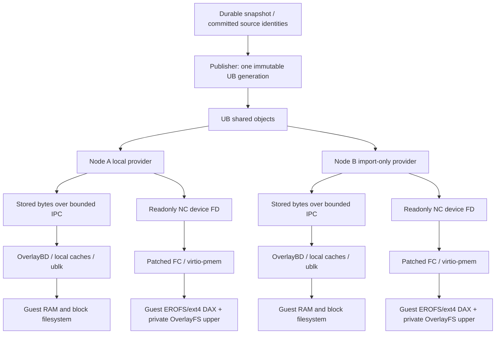

# Cross-node CoW: implementation and acceptance boundary

This branch is an opt-in implementation candidate. It is not an end-to-end
validated implementation of globally shared Guest RAM and rootfs. Existing
sandbox behavior is retained when the new environment variables are absent.

## Two different sharing paths

The stored-layer path shares **stored immutable bytes** for both memory and
rootfs. It does not eliminate IPC copies, each node's decoded memory device,
Guest RAM, or Guest filesystem cache. It must not be reported as direct sharing
of all Guest base physical pages.

The native rootfs path exposes compact, uncompressed filesystem images directly
as readonly pmem. The Guest mounts EROFS or explicitly selected ext4 with DAX and overlays a private writable
ext4 directory. DAX is checked on every nonempty regular file in each lower and
the initial visible root. The final probe is checked again after envd readiness.
A failed DAX check is a failed launch, not permission to use an ordinary cache
path. Application buffers, parsed data, private writes, page tables and pmem page
metadata still consume memory.

## Components

* AgentENV validates immutable identities, acquires same-UID provider leases and
  passes both data and lease FDs into isolated children. The NC verifier has zero
  capabilities and verifies the full device range without mapping it in the
  Runtime. Device faults fail that child. Cancellation retains ownership until
  reaping; inherited lease sockets also pin stalled children.
* `components/ub-memory-provider` uses public UB shmem APIs compiled against the
  installed SDK headers. Publish and import roles are separate. Import never
  allocates or deletes publisher objects. All parameters are explicit; there are
  no hostnames, fixed UIDs, deployment paths, service operations or SDK installers.
* `components/firecracker-native-pmem` supplies an explicitly versioned NC device
  FD backend. It duplicates all inherited segments, preserving `O_SYNC`, and maps
  them into one owned aligned range. It does not seek, pread, reopen `/proc/self/fd`, or manufacture
  a local copy. The patch applies only to the source hashes in `baseline.json`.
* `components/native-fd-verifier` is the isolated executable used above.
* `tools-image` supplies Guest pmem/EROFS/ext4/OverlayFS startup and the DAX checker.
* `aenv-export-memory` exports a full linear immutable RAM view with sparse zero
  ranges in its **local output file**. This does not make a UB allocation sparse.

## Opt-in configuration

Stored-layer runtime hints use `AENV_UB_MEMORY_REPLICAS` and
`AENV_UB_ROOTFS_REPLICAS`, pointing to node-local `runtime-index.json` files.
The durable repository remains authoritative. Bindings require matching digest
and length, and fallback defaults to false. A native rootfs binding cannot be
combined with the rootfs stored-layer hint for the same launch.

`AENV_DIRECT_ROOTFS_BINDING` selects the version-2 cold-boot pmem binding made by
the provider's `bind-rootfs` command. It pins verifier and FC binary SHA256s,
source identities, per-layer image hashes and lengths, and an explicit exposed
address-range limit. The provider socket and binaries must be configured for
each node. Source identities and content hashes are portable; FD numbers and
socket paths are not.

The optional `lowerFilesystem` field is a strict `erofs`/`ext4` choice and
defaults to EROFS for existing bindings. All lowers in one binding use that
type. Ext4 lowers are immutable 4KiB-block images without inline data or a
journal requiring replay; mount options are `ro,noload,dax=always`. The upper
remains a separate writable ext4 directory. Both choices retain the same actual
file-DAX checks, including the merged OverlayFS root; there is no cache fallback.

`AENV_DIRECT_MEMORY_BINDING` selects the full linear RAM consumer. Its provider
must support a readable, seekable, cacheable, readonly FD with genuine writable
private mappings under KVM. **The supplied NC pmem provider rejects this RAM
contract.** The tested NC readonly device mapped readonly successfully but its
tested private writable mapping failed. A local memfd copy is not a substitute
for cross-node sharing and is not supplied as a successful UB mode.

The generic `aenv_` object namespace replaces the earlier experimental wire
namespace. Regenerate indexes with the matching provider. Old experimental
indexes are rejected; they are never rewritten or deleted automatically.

## Deliberate limitations

The native FC patch includes a strict ARM64 GNU seccomp resource. The normal
target build embeds it; the native mapping backend does not require disabling
seccomp. This policy preserves the reviewed musl rules and adds only GNU VMM
thread signalling and join operations with explicit signal/futex argument
restrictions. Missing ARM64 GNU policy input fails the build instead of falling
back to an empty policy. Updating a resource in a checkout does not update an
already deployed executable: rebuild, record its digest, and verify that binary
before changing a rootfs binding. See the native FC component README for the
exact input hashes and policy scope.

1. Native writable Guest RAM CoW remains unimplemented for the tested NC device.
   A platform-backed private mapping contract or a fully implemented FC/KVM
   write-privatization mechanism is required. No unvalidated signal handler or
   kernel patch is installed by this branch.
2. Native pmem currently supports cold boot only. Capture, pause/Fork and restore
   are refused before VM mutation because durable pmem reconstruction and
   coordinated references across snapshot generations are not implemented.
   Consequently native pmem cannot yet be combined with native RAM snapshot
   restore to satisfy the full target.
3. Each native image may span up to 32 SDK backing units. Ordered FD/length
   metadata, complete SCM_RIGHTS delivery and exact coverage are checked. The
   verifier and FC share the same readonly segment mapper. Larger images fail;
   there is no silent copy or first-segment-only publication. Actual multi-unit
   UB mapping and KVM access still require target validation.
4. Prebuilt EROFS/ext4 input must be trustworthy and faithfully represent its committed
   source. Hash binding does not prove filesystem conversion correctness. The
   Guest kernel must actually support virtio-pmem, pmem block devices, selected filesystem DAX
   and the final OverlayFS DAX path. These are hardware acceptance prerequisites.
5. The existing rootfs device supplies the private upper directory. Eliminating
   its unnecessary base data by producing an independent blank upper disk is
   still required for an optimized deployment.
6. UB logical size and SDK backing coverage are not physical usage. Whole-image
   publication and verification touch all image bytes and are preparation work.
   A fully populated image may cost more than the original hot working set.
7. The provider requires a trusted lifecycle coordinator to freeze new imports,
   keep one active importer per configured reader identity, and deliver explicit
   release receipts before publisher retirement. Local socket EOF, timeout or
   node failure never proves all remote readers have stopped. Crash recovery and
   automatic distributed garbage collection are not implemented.

## Required comparison

Use the same committed input, Guest resources, task trace and sampling points
for original CoW, this branch with UB disabled, stored-layer UB, and native pmem.
Start with one and then two Guests per node. Check common-read correctness,
disjoint private writes, unchanged base hashes, remaining readers after one
Guest exits, and complete generation retirement. Native RAM needs an explicit
write-privatization acceptance result of its own.

Within one node, form each Guest's set of resident physical base pages, excluding
duplicate virtual aliases. Let `A` be the sum of those set sizes, `U` their union,
and `B` pages present in at least two Guest sets. Shared unique bytes are
`B * page_size`; avoided duplicates are `(A - U) * page_size`; shared participation
is `sum(reference_count(p) for p in B) / A`; avoided-duplicate ratio is `(A-U)/A`.
Masked PFNs and permission failures are unknown, never zero. PFNs from different
nodes cannot be compared directly.

For global savings, count each real UB allocation once and include node-local
copies/caches, Guest private pages, uppers and auxiliary processes. Guest file
cache is already part of Guest RAM. Do not add overlapping counters such as
whole page cache plus process PSS. At matched workload points:

`net_saved_bytes = baseline_unique_physical_bytes - candidate_unique_physical_bytes`

`net_saved_ratio = net_saved_bytes / baseline_unique_physical_bytes`

Do not emit a numeric net saving without complete, comparable physical accounts.
Identical hashes, shared object names, read traffic, SDK coverage and process RSS
alone do not establish this result. The branch contains no laboratory deployment
or relay scripts, private data, credentials or measured benchmark claims.
