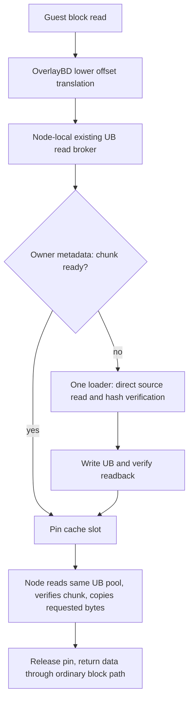

# Demand-filled rootfs data in UB

This opt-in candidate implements a bounded shared cache for immutable **stored
lower bytes**, through the existing OverlayBD/ublk read path. It is separate from
the full-image native pmem/DAX implementation. No running services, deployment
scripts, Guest images, SDK/driver code or native FD contracts are changed.

The desired behavior is: a node requests a chunk; if it is already ready in UB,
the node reads the shared copy; otherwise one owner fills it from durable
storage, verifies it and wakes waiters. Upper writes remain instance-private.

## What is implemented



* Immutable chunk identity is `(stored layer SHA256, 64KiB chunk index)`. A
  separately prepared, pinned catalog contains complete-file and chunk hashes.
  Multiple templates using the same layer share cache entries.
* One publisher coordinates all fills and slot assignments. Remote readers
  receive only small metadata grants, read payload from their readonly mapping
  of the **same SDK pool object**, and verify each chunk before returning data.
* A bounded pool is allocated once. Startup reads no source payload and does
  not fill the pool. This is demand **filling**, not demand physical allocation.
* Concurrent requests for a missing retained chunk share one fill. Slots are
  LRU-evicted only when they are neither loading nor pinned. A full pinned pool
  returns an error; it does not silently allocate more memory or fall back.
* A pin is journaled and fsynced before its grant is sent. A lost response,
  timeout or disconnected reader never implicitly unpins a slot. Unknown pins
  block retirement and can reduce usable capacity until operator reconciliation.
  An authenticated explicit chunk release removes the live pin after its read
  completes, but does not require a second journal commit. The durable journal
  can retain a conservative superset of old pins until the next grant, reader
  release, or freeze writes the full live set. New grants and final retirement
  checkpoints remain durable before acknowledgment. This reduces per-chunk
  journal writes; it adds no crash-resume or automatic stale-pin recovery and
  does not establish a hardware performance gain.
* Source reads use Linux `O_DIRECT` and an aligned temporary buffer, with no
  buffered fallback. This avoids adding source-file pagecache through these
  reads; filesystem/device support must be validated on the target. Tail chunks
  retain their exact byte length. Source FD identity is checked on each read.
* Importers never allocate, write to, or delete UB objects. One admission per
  configured reader prevents accidentally starting duplicate importers.
* Retirement first stops the local broker with no live read sessions. An
  importer unmaps/finalizes locally before acknowledging release. The publisher
  deletes its pool only after every configured reader released, no chunk pins
  or fills remain, and coordinator workers have stopped.

Metadata is authoritative in one owner process, not in uncoordinated local
bitmaps. There is no automatic failover, lease expiry or crash recovery. A
generation directory is created exclusively and is never blindly resumed.

## Explicit boundaries

This path still copies bounded data into the node's consumer and Guest RAM.
Guest filesystem cache, decoding/index state and temporary I/O buffers remain.
It does not implement memfile private CoW or eliminate every local copy.

Native pmem/DAX has no implemented mechanism that can suspend a Guest access to
an unfilled UB range, fetch/verify the missing content, and safely map or revoke
that range. The lazy pool is deliberately **not** exported as a pmem device. Its
slots can change identity after pins close; handing its FDs to a Guest as an
immutable filesystem would be incorrect. Native imports reject this manifest.
Transparent DAX demand paging still requires a compatible missing-access and
mapping-invalidation mechanism. It is not enabled by `mmap` or by a ready bitmap.

The existing native verifier also hashes the complete exposed image before
launch. Keeping that contract unchanged would read every chunk even if a
missing-access handler were added. A future native demand contract must bind a
trusted immutable chunk catalog and verify chunks before mapping, rather than
silently dropping verification or retaining a full-image warmup.

That future native contract must provide all of the following before it can
consume this cache safely:

1. A missing-access event that blocks both Guest data loads and instruction
   fetches, including accesses initiated through KVM, until verified content is
   available. The current NC device FD handoff supplies no such event.
2. A stable image-offset mapping whose permissions and backing ranges can be
   updated through a supported interface. Ordinary-file `userfaultfd` behavior
   must not be assumed to apply to this device's PFN mappings.
3. Pins that last for the entire duration of a Guest mapping. The current read
   broker releases after copying; that lifetime is insufficient for DAX.
4. A revocation protocol acknowledged by every local/remote mapper before a
   slot is reused, including stage-2/KVM and CPU translation invalidation as
   required by the platform. Timeout or lost contact cannot acknowledge it.
5. A versioned snapshot reference to immutable content/catalog identities that
   reconstructs mappings and reacquires pins. Mutable cache slots, process FD
   numbers and temporary UB incarnations cannot be durable snapshot identities.

Implementing a ready bitmap alone, removing the full-image verifier, using a
local RAM copy, or exposing an uninitialized range would not satisfy these
requirements. This implementation intentionally does none of those things.

The current source adapter reads existing immutable local committed files on
the publisher. It does not implement registry/OSS HTTP downloads. The source
range-read boundary allows a repository adapter later, but no such adapter is
claimed here. Direct source I/O, the actual SDK pool, cross-node visibility,
full Guest replay and net physical savings require Linux/hardware acceptance.

## Offline preparation

Run from `components/ub-memory-provider`, or use the installed `aenv-ub-lazy`
entry point. All directories must already be accessible to the ordinary runtime
user. No root setup or service restart is performed.

```sh
python3 -B -m aenv_ub_provider.lazy_service prepare \
  --source-root /srv/aenv/snapshots \
  --image /srv/aenv/snapshots/template/rootfs/image.json \
  --output /srv/aenv/catalogs/rootfs-chunks.json
```

Repeat `--image` to include all selected templates; shared layers are deduplicated.
Preparation explicitly reads every selected source byte to validate the
committed identity and build chunk proofs. Do it outside the replay measurement
window and reuse the resulting catalog. It may warm local source pagecache;
serving does not clear or pretend to eliminate that existing cache.

## Publisher configuration

```json
{
  "version": 1,
  "role": "publish",
  "workDir": "/srv/aenv/ub/lazy-generation-a",
  "adapter": "/srv/aenv/bin/libaenv-ub.so",
  "adapterSha256": "sha256:<actual-built-adapter-hash>",
  "region": "default",
  "maxCoverageBytes": 536870912,
  "poolBytes": 67108864,
  "sourceRoot": "/srv/aenv/snapshots",
  "catalog": "/srv/aenv/catalogs/rootfs-chunks.json",
  "catalogSha256": "sha256:<exact-catalog-file-hash>",
  "readers": ["node-b"]
}
```

These example capacities are not sizing recommendations or physical quotas.
Pool size is a positive 4MiB multiple, up to 4GiB; the SDK may expose more backing
coverage, checked against the explicit inspection limit only after mapping.

```sh
python3 -B -m aenv_ub_provider.lazy_service serve publisher.json
python3 -B -m aenv_ub_provider.lazy_service serve publisher.json --run
```

The first command only validates inputs. Only `--run` calls the SDK. Serving
emits a portable `manifest.json`, node-local `runtime-index.json`, private
`reader-<id>.json` credentials and `owner.json`. Transfer the manifest and only
the intended reader's credential through an approved private transport. Do not
publish credentials or copy the owner credential to another node.

## Importer configuration and transport

```json
{
  "version": 1,
  "role": "import",
  "workDir": "/srv/aenv/ub/lazy-generation-b",
  "adapter": "/srv/aenv/bin/libaenv-ub.so",
  "adapterSha256": "sha256:<actual-local-adapter-hash>",
  "region": "default",
  "maxCoverageBytes": 536870912,
  "manifest": "/srv/aenv/import/manifest.json",
  "credential": "/srv/aenv/import/reader-node-b.json",
  "coordinationSocket": "/srv/aenv/import/forwarded-coordinator.sock"
}
```

The credential pins the canonical manifest SHA256, generation and distinct
reader identity. Import never needs a source-file copy. The coordinator endpoint
is an owned local UNIX socket. Cross-node metadata forwarding must be supplied
by the operator's approved authenticated transport (for example, SSH stream-local
forwarding to the publisher's `coordinator.sock`). This code does not create
connections to hosts, install SSH keys, expose a TCP service or assume that UNIX
sockets themselves cross nodes. Both local endpoints enforce same-UID access.
Payload is not forwarded through that metadata channel.

Run the importer with the same `serve` syntax. Use the node-local generated
index as `AENV_UB_ROOTFS_REPLICAS` for a separately configured test Runtime. Do
not combine it with `AENV_DIRECT_ROOTFS_BINDING` for the same launch. Existing
normal services and native four-template tests are not switched automatically.

The index retains existing version-1 broker compatibility. Its layer object
names are **virtual broker views**, not full-layer SDK allocations; their
`mappingBytes` fields are legacy wire range envelopes. Only `manifest.pool`
describes the actual allocation. Never feed these virtual descriptors to the
ordinary full-layer importer or add their lengths up as allocated UB memory.

## Observe and retire

```sh
python3 -B -m aenv_ub_provider.lazy_service status /srv/aenv/ub/lazy-generation-b
python3 -B -m aenv_ub_provider.lazy_service retire /srv/aenv/ub/lazy-generation-b
python3 -B -m aenv_ub_provider.lazy_service retire /srv/aenv/ub/lazy-generation-a
```

Stop/release the cohort Guests before retirement. Retire every importer before
the publisher and keep metadata transport available until acknowledgments finish.
No timeout is a substitute for explicit cleanup. A failed/interrupted generation
retains object names, credentials and its pin journal; do not remove its directory
and start again under new names without reconciliation.

`status` reports global hit/miss/wait/eviction/fill-error counts, bytes returned
by successful backend read calls (including rejected contents), valid ready
payload bytes, configured pool bytes, loading/pin counts, and node-local completed
broker read requests/bytes. These are different quantities. In particular:

* A 4KiB request can load a 64KiB chunk, and an evicted chunk may be loaded again.
* `readyBytes` can fall while the allocated pool remains the same size.
* `backingCoverageBytes` in the journal is not a measured physical increment.
* Startup payload bytes zero does not mean startup physical cost zero.
* Preexisting ordinary filecache, Guest RAM, upper, metadata and copy buffers
  must all be considered in an end-to-end memory comparison without double count.

Lazy manifests use format `aenv-ub-lazy-v2` and `chunkBytes: 65536`. Earlier
1MiB manifests/catalogs are rejected rather than reinterpreted. Existing
OverlayBD broker requests remain bounded at 1MiB and can span sixteen cache
chunks; changing fill granularity does not change that wire protocol.

## Validation

Run from the repository root:

```sh
python3 -B -m unittest discover -s components/ub-memory-provider/tests -v
```

Tests exercise cold startup with zero payload, shared fills, overlapping readers,
cross-chunk/tail reads, pinned eviction refusal, LRU reload, corrupt backend/UB
data, stale grants, lost replies, journal failure, duplicate importer admission,
cleanup ordering, and the unchanged binary read protocol. SDK and resource
lifecycle tests use explicit models; UNIX path/credential checks are modeled
where required on Windows. They are not Linux direct-I/O, UB SDK, KVM/DAX,
two-node or performance acceptance.

## Optional content access and ready-set observation

The `overlaybd/rootfs-read-trace` build feature propagates the rootfs image-config
identity through ublk IO context. Local file reads retain their inode attribution;
UB reads emit successful stored-content ranges with digest, length, source image
config, monotonic start/end and actual UB-versus-repository source. The observer
records no payload. It is disabled by default and does not change read results.
These are underlying stored-layer reads, including format/decompression reads;
they are not exact Guest application demand bytes or measured hardware IO.

An opt-in observer executable reads its adjacent `.access-spec` file. The spec
uses `output=`, `max_bytes=`, `max_records=`, `allow=dev:inode:file_bytes`, and
`allow_content=sha256:hex:file_bytes`. Its private owned output directory must
exist and output/status files must be new. Version 2 trace headers include both
allowlist counts. Sequence/error/drop/unsupported-context status makes incomplete
coverage visible. A missing observer, absent source binding or stale/incomplete
status means unknown coverage, never a measured zero. Logging can add latency
and Host file cache; account for observer files and compare equally instrumented
binaries when measuring overhead.

`lazy_service residency WORK_DIR` fetches one bounded, immutable diagnostic
copy of the owner's ready content ranges. It uses the existing authenticated
metadata channel and 4KiB wire limit, with at most 16 rows per page. A row is
`[digest, stored_offset, valid_bytes, slot]`. The header carries cache generation,
owner monotonic/wall time, ready bytes and pool capacity. The diagnostic copy
expires after 60 seconds or is replaced by a newer request; this never expires
a reader lease or permits slot reuse. Paging a superseded copy fails explicitly.
Diagnostic transport errors do not mark data-plane reader leases uncertain.

The snapshot identifies content valid in the already allocated UB pool; it is
not a measurement of physical allocation increment or device residency. Form
each Guest's completed-read page set, intersect it with the same observation
window's valid content set, then compute unions/intersections by content identity.
Do not compare monotonic timestamps across nodes without a coordinated window
or calibrated clock relationship. Do not substitute a local lower file's zero
mincore count, full ready bytes, or aggregate provider read bytes for actual
per-Guest intersections. Cross-node content overlap alone is not physical net
saving: local Guest caches, private uppers, UB capacity and auxiliary costs still
require separate non-overlapping accounts.
